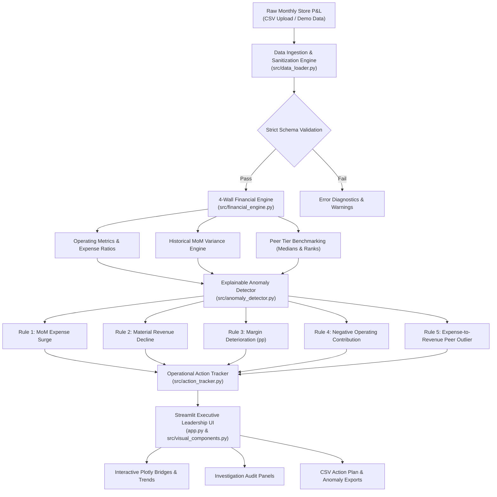

# 🏬 StorePulse: Retail P&L Intelligence Agent

> **Store-Level Operating Contribution & Unit Economics Diagnostic Platform**  
> Designed as a high-impact portfolio project for the **Wakefit Management Trainee (MT) — Retail Operations & Strategy** application.

---

## ⚠️ Mandatory Synthetic Data Disclaimer
> **IMPORTANT COMPLIANCE DISCLOSURE:**  
> All financial, store, and operational data contained in this project and repository are **100% synthetic, deterministic simulations** generated for educational, portfolio, and analytical demonstration purposes.  
> **This dataset does NOT contain real, confidential, or proprietary financial data of Wakefit Innovations Pvt. Ltd.** or any specific commercial enterprise.

---

## 📌 Executive Summary & Business Problem

As modern omnichannel retail brands (such as Wakefit) scale from dozens to hundreds of physical experience centers and flagship stores across Tier-1 and Tier-2 Indian markets, retail operations and commercial finance leadership face critical challenges:

1. **Information Asymmetry & Lag:** Store-level P&Ls are typically compiled 15–20 days after month-end in fragmented spreadsheets, delaying corrective operational interventions.
2. **Hidden Unit-Economics Leakage:** Aggregate network profitability frequently masks localized inefficiencies—such as localized HVAC/utility failures, runaway unapproved contract overtime, or uncoordinated local store marketing (BTL) campaigns.
3. **Misleading Accounting Jargon:** Blending direct store 4-wall cash costs with corporate central allocations (supply chain COGS, central brand marketing, HQ SG&A, corporate debt servicing) obscures true store-level operational contribution.
4. **Lack of Actionable Accountability:** Traditional dashboards present static charts without linking anomalies to assigned operational owners, root-cause investigation protocols, and resolution deadlines.

**StorePulse** solves this by acting as an **explainable retail P&L intelligence agent**. It ingests monthly store P&L data, computes standardized 4-wall unit economics, benchmarks stores against peer cohorts, identifies statistical and operational anomalies using transparent rules, and initiates structured operational action workflows.

---

## 🏛️ System Architecture



---

## 📐 Mathematical & Financial Framework

StorePulse strictly avoids ambiguous or misleading corporate accounting terminology. It evaluates direct store-level performance using **Store Operating Contribution Proxy (4-Wall Cash Margin)**:

### 1. Total Direct Store Operating Expenses ($E_{store}$)
$$E_{store} = \text{Rent} + \text{Payroll} + \text{Marketing} + \text{Utilities} + \text{Other Expenses}$$

### 2. Store Operating Profit Proxy ($P_{store}$)
$$P_{store} = \text{Revenue} - E_{store}$$
*Represents direct cash generation of the physical showroom before corporate central overhead, inventory cost of goods sold (COGS), and centralized depreciation.*

### 3. Store Operating Contribution Margin ($M_{store}$)
$$M_{store} = \begin{cases} \left(\frac{P_{store}}{\text{Revenue}}\right) \times 100\% & \text{if } \text{Revenue} > 0 \\ 0.0\% & \text{if } \text{Revenue} \le 0 \end{cases}$$

### 4. Sequential Month-over-Month Variance ($\Delta_{MoM}\%$)
$$\Delta_{MoM}\% = \left(\frac{V_t - V_{t-1}}{|V_{t-1}|}\right) \times 100\%$$

### 5. Margin Shift in Percentage Points ($\Delta_{pp}$)
$$\Delta_{pp} = M_t - M_{t-1}$$

---

## 🚨 Configurable, Explainable Anomaly Detection Rules

StorePulse avoids "black-box" models or hallucinated root causes. Every alert provides an explicit audit trail consisting of **Triggering Rule**, **Baseline Value**, **Current Value**, **Absolute Variance**, **Percentage Shift**, and **Recommended Operational Investigation**:

| Rule Identifier | Trigger Condition | Severity | Seeded Benchmark Example |
| :--- | :--- | :--- | :--- |
| **MoM Expense Surge** | Category growth $\ge +35\%$ MoM **AND** absolute surge $\ge ₹75,000$ | High ($\ge 60\%$) / Medium | **ST-04 (Mumbai Andheri)**: Utilities surged $+140.5\%$ in Feb 2026 due to HVAC compressor breakdown & continuous commercial DG operation. |
| **Material Revenue Decline** | Revenue drops by $\le -20.0\%$ MoM | High ($\le -30\%$) / Medium | **ST-08 (Hyderabad Gachibowli)**: Revenue dropped $-42.3\%$ in Mar 2026 due to metro flyover road closure blocking store access. |
| **Margin Deterioration** | Operating margin compresses by $\ge 8.0$ percentage points MoM | High ($\ge 12\text{ pp}$) / Medium | **ST-06 (Gurgaon Sec 29)**: Margin compressed by $14.2\text{ pp}$ in Jan 2026 following uncoordinated marketing spend during footfall slump. |
| **Negative Store Contribution** | Store Operating Profit Proxy $< 0$ (store operates at cash loss) | High | **ST-08 (Mar 2026)**: Incurred negative contribution of $-₹1.72\text{ L}$ ($M_{store} = -6.9\%$). |
| **Expense-Ratio Peer Outlier** | Expense ratio $\ge 1.5\times$ peer tier median **AND** $\ge +3.0\text{ pp}$ delta | Medium | **ST-10 (Pune Koregaon)**: Other expenses spiked to $10.5\%$ of revenue vs Tier-2 median of $3.6\%$ due to plumbing damage repair. |

---

## 🧪 Comprehensive Automated Testing

StorePulse maintains a rigorous automated test suite with **24 unit and integration tests** covering:
- Zero revenue and division-by-zero boundary conditions
- Negative cash contribution and expense inflation
- Missing columns, invalid string coercion, and duplicate `(store_id, month)` row sanitization
- Anomaly threshold boundaries (evaluating exact edge limits)
- End-to-end headless Streamlit UI integration tests using `streamlit.testing.v1.AppTest`

Run all tests locally:
```bash
python -m pytest tests/ -v
```

---

## 🚀 Local Installation & Quickstart

### Prerequisites
- Python 3.10+ (Tested on Python 3.11)
- Git

### 1. Clone the Repository
```bash
git clone https://github.com/your-username/storepulse.git
cd storepulse
```

### 2. Create and Activate Virtual Environment
```bash
# Windows
python -m venv venv
venv\Scripts\activate

# macOS / Linux
python3 -m venv venv
source venv/bin/activate
```

### 3. Install Dependencies
```bash
pip install -r requirements.txt
```

### 4. Run the Streamlit Application
```bash
streamlit run app.py
```
Open your browser and navigate to `http://localhost:8501`.

---

## ☁️ Deployment Guide

### Deploying to Streamlit Community Cloud (Free & 1-Click)
1. Fork or push this repository to your GitHub account as a public repository.
2. Sign in to [Streamlit Community Cloud](https://share.streamlit.io/).
3. Click **"New app"**.
4. Select your repository: `your-username/storepulse`, Branch: `main`, Main file path: `app.py`.
5. Click **"Deploy"**. The app will be live within 90 seconds.

---

## ⚠️ Current Limitations & Roadmap

### Current MVP Scope
- **Session-Only Persistence:** Action item status updates and custom tasks are maintained in Streamlit's active browser session memory and can be exported as CSV. Permanent multi-user persistence requires an external database (PostgreSQL/Supabase).
- **Single-File CSV Ingestion:** Ingests consolidated store monthly P&L tables.

### Future Roadmap
- [ ] **Direct ERP/POS Connectors:** Automated webhook ingestion from SAP, Netsuite, or Shopify POS.
- [ ] **Store Footfall & Conversion Telemetry:** Ingest footfall camera sensors to calculate footfall conversion and revenue per visitor.
- [ ] **Automated PDF Executive Briefings:** One-click generation of monthly regional review packs for Area Managers.
- [ ] **Persistent PostgreSQL Action Tracker:** Full CRUD database backend with Slack and email escalation alerts.

---

## 👤 Author & Context
- **Project:** StorePulse Retail P&L Intelligence Agent
- **Applicant:** Management Trainee Candidate — Retail Operations & Strategy
- **Target Organization:** Wakefit Innovations Pvt. Ltd.
- **Tech Stack:** Python, Streamlit, Pandas, Plotly, Pytest
